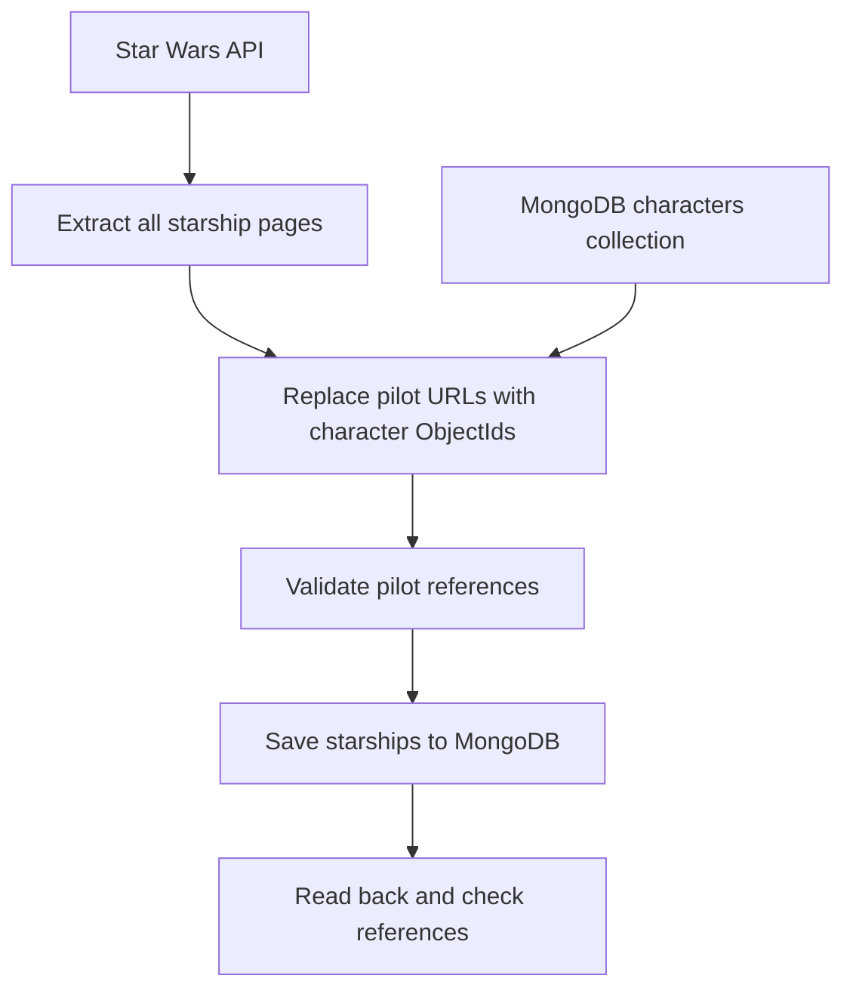
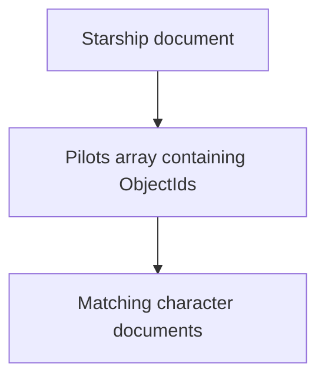

<div align="center">

# Star Wars Starship Data Pipeline

### Python ETL · API Integration · MongoDB Referencing · Unit Testing

A Python project that retrieves starships, links their pilots to existing MongoDB characters and checks the references.

**Created by Sumiyya during Sparta Global data engineering training**

[Overview](#overview) · [Pipeline](#pipeline) · [Getting started](#getting-started) · [Testing](#testing) · [Results](#results)

</div>

---

## Overview

For this project, I built an ETL pipeline using Python and MongoDB.

I retrieved starship data from the Star Wars API, replaced the pilot URLs with references to characters already in my database, and saved the transformed starships into their own collection.

The project includes:

- Pagination to retrieve all starship pages
- Pilot references using MongoDB ObjectIds
- Checks for missing characters and broken references
- Updates or inserts when saving starships
- Error handling and request timeouts
- Six unit tests using mocking
- An example query displaying a starship and its pilot names

I confirmed that the completed collection contained **36 starships**, and **all six unit tests passed locally**.

## Tools used

| Tool | How I used it |
|---|---|
| Python | Writing the pipeline and processing the data |
| Requests | Retrieving starship and pilot data from the API |
| PyMongo | Connecting to MongoDB and working with documents |
| MongoDB | Storing characters and starships |
| MongoDB Compass | Inspecting the saved data |
| unittest | Writing and running automated tests |
| unittest.mock | Replacing external calls during testing |

## Pipeline



## How it works

### 1. Extract the starships

In `get_starships()`, I send a request to the starships API endpoint.

The results are spread across multiple pages, so I use a while loop to follow the next page URL and add each page’s results to one list. The loop stops when there is no next page.

### 2. Find the pilot IDs

In `get_pilot_ids()`, I loop through the pilot URLs listed for a starship.

For each URL, I retrieve the pilot’s name from the API and search for the matching character in MongoDB. If a match is found, I add their ObjectId to a list. If no match is found, I raise an error.

This approach assumes the character names in MongoDB match the API names and identify the correct characters.

### 3. Replace the pilot URLs

In `replace_pilot_links()`, I loop through the starships and replace each ship’s pilot URLs with the ObjectIds returned by the previous function.

Ships without listed pilots keep an empty list.

This creates references to the existing character documents without copying their full details into each starship.

### 4. Validate the references

In `validate_pilots()`, I check that every stored pilot ID points to an existing character.

I run this before saving and again after reading the saved documents back from MongoDB.

The check confirms that the referenced characters exist. It does not independently verify that each character is the correct pilot for a particular ship.

### 5. Save the starships

In `save_starships()`, I use each starship’s API URL to find a matching document.

I use `update_one()` with `$set` and `upsert=True`. This updates a matching starship or inserts it if it does not already exist.

### 6. Display a linked starship

The script retrieves the Millennium Falcon and loops through its stored pilot IDs.

It then looks up each character and prints their name, demonstrating how the references connect the two collections.

## Data relationships

The `pilots` field is an array of references to documents in the characters collection.



| Collection | Contents |
|---|---|
| `characters` | Character documents imported before running the pipeline |
| `starships` | Starship documents containing references to their pilots |

## Project files

| File | Purpose |
|---|---|
| `main.py` | Extract, transform, validate and load the data |
| `test_main.py` | Test selected behaviours using mocks |
| `README.md` | Explain the project, setup and results |

## Getting started

### Requirements

- Python 3
- MongoDB running locally
- Internet access to retrieve API data
- Star Wars character data imported into MongoDB

### Install the dependencies

```bash
pip install requests pymongo
```

`unittest` and `unittest.mock` are included with Python.

### Prepare MongoDB

The script uses this connection address:

```text
mongodb://localhost:27017/
```

It uses a database called `starwars`.

Before running the script, import the Star Wars character data into its `characters` collection. Each character must have a `name` field matching the API data.

The script loads the starships into the `starships` collection.

### Run the pipeline

From the folder containing `main.py`, run:

```bash
python main.py
```

The terminal displays progress messages, the number of starships processed, reference validation counts and the Millennium Falcon’s pilot names.

## Testing

I wrote six unit tests to check selected behaviours in the pipeline.

| Test | What it checks |
|---|---|
| `test_get_starships` | Returns the expected starship from a single API page |
| `test_get_pilot_id` | Returns the matching character ObjectId and searches by the expected name |
| `test_missing_pilot` | Raises an error when the character cannot be found |
| `test_no_pilots` | Returns an empty list without a character lookup |
| `test_save_starship` | Sends the expected update command with upsert enabled |
| `test_connection_failure` | Handles a simulated connection failure and closes the client |

### Run the tests

```bash
python -m unittest -v test_main
```

My local run completed with:

```text
Ran 6 tests

OK
```

### Why I used mocking

I used mocks for the API responses and MongoDB calls so I could control the test data and check how my functions behave.

The unit tests do not depend on the live API or change the real database. They check my code’s behaviour; the actual saved data was checked separately in MongoDB Compass.

## Results

### Starship collection

I confirmed that the `starships` collection contained **36 documents** in MongoDB Compass.

### Pilot query

To inspect the Millennium Falcon in Compass, open `starwars`, select `starships` and enter:

```json
{"name": "Millennium Falcon"}
```

Expand the `pilots` array to see its character ObjectIds.

Running `main.py` also looks up these references and prints the corresponding character names.

<!--
To display screenshots, upload the following files into an images folder
and remove this comment block.

### MongoDB collection


### Linked pilot names


### Passing unit tests


-->

## Error handling

The script includes checks for:

- Unsuccessful API requests
- MongoDB errors
- An empty characters collection
- Missing characters
- Broken pilot references
- Missing dictionary keys

API requests have a timeout, and the MongoDB connection is checked using `ping`.

Errors caught by the script are displayed in the terminal. A `finally` block closes the MongoDB client when processing finishes.

## What I learned

This project helped me apply the extract, transform and load process in Python.

I practised retrieving paginated API data, linking MongoDB documents using ObjectIds and checking references before and after loading.

Writing the tests also helped me understand how mocking lets me test my code separately from the external API and database.

## Possible improvements

- Add a test covering multiple API pages
- Add retry logic for temporary request failures
- Automatically check the final collection count
- Add a unique index on starship URLs to enforce uniqueness
- Explore the optional relational SQL extension
